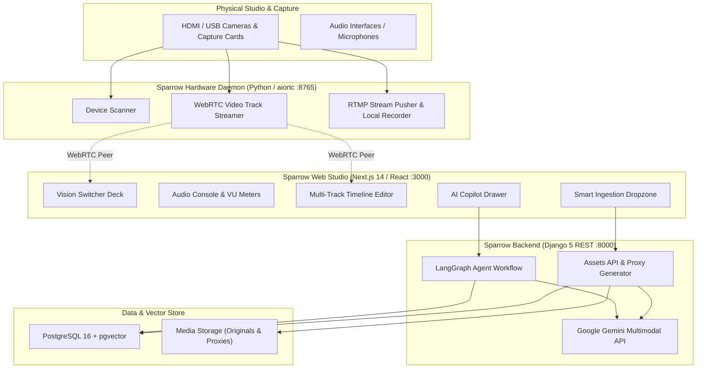

# 🕊️ Sparrow Media OS

> **The Unified Next-Generation Media Operating System & AI Production Suite**  
> Seamlessly bridging physical capture hardware, real-time live broadcast switching, professional multi-track non-linear video editing (NLE), and autonomous generative AI editing agents into a single browser-native platform.

---

[](https://nextjs.org/)
[](https://react.dev/)
[](https://www.typescriptlang.org/)
[](https://www.djangoproject.com/)
[](https://webrtc.org/)
[](https://github.com/pgvector/pgvector)
[](https://deepmind.google/technologies/gemini/)
[](https://pnpm.io/)

---

## 🌟 Key Features

### 🎬 Studio & Live Broadcast Switcher (`apps/web`)
* **Vision Switcher Deck**: Professional Program (PGM) and Preview (PVW) video busses with Cut, Auto, Mix, Fade-to-Black (FTB), and custom duration transitions.
* **Compositing & Overlays**: Real-time picture-in-picture (PiP), multi-box split-screen, and dynamic lower-third graphics.
* **Audio Console**: Multi-channel live audio mixer with stereo master bus, decibel peak indicators, and responsive canvas-driven VU meters.
* **Broadcast Engine**: Start on-air live streams via RTMP directly to YouTube Live, Twitch, Facebook, or pipe to local recording sinks with live telemetry.

### ✂️ Non-Linear Timeline Editor (NLE) & EDL
* **Multi-Track Editing**: Concurrent video, audio, and graphics tracks with frame-accurate timecode navigation (`HH:MM:SS:FF`).
* **Interactive Timeline**: Scrubbing, split/cut at playhead, ripple deletion, snapping, zoom scaling, and waveform rendering via dedicated Web Workers.
* **Shared EDL Package (`@sparrow/edl`)**: Typed data contracts for Edit Decision Lists, clip effects, track volume/mute/solo states, and export specifications.

### 🤖 Autonomous Multi-Agent AI Pipeline (`backend/agents`)
* **LangGraph Agent Workflow**: Orchestrated supervisor routing that decomposes natural language editing instructions into precise timeline edits.
* **Speech Transcription Node**: High-accuracy speech-to-text with timestamped words and pause detection.
* **Smart Trimmer Agent**: Automatically detects and trims dead air, filler words, and awkward pauses while preserving audio cadence.
* **Semantic B-Roll Agent**: Identifies contextual talking points and automatically selects and overlays matching archival footage or graphics onto the B-roll track.
* **Conflict Resolution Node**: Resolves overlapping cuts, clip transitions, and audio sync issues before committing to the EDL.

### 🔌 Hardware Bridge & WebRTC Streaming (`daemon`)
* **Hardware Device Scanner**: Discovers local physical HDMI/USB capture cards (e.g. Elgato, Cam Link), webcams, and virtual camera inputs across DirectShow, V4L2, and AVFoundation.
* **Ultra-Low-Latency WebRTC**: Streams hardware capture feeds directly into browser canvas monitors via `aiortc` without intermediary capture software.
* **RTMP Pusher**: Direct hardware-accelerated broadcast streaming from capture cards to remote CDNs.

### 🔍 Multimodal Semantic Asset Management (`backend/assets`)
* **Automated Proxy & Thumbnail Pipeline**: Asynchronous background generation of low-bitrate edit proxies and scrubbing filmstrips.
* **Gemini Multimodal Embeddings**: Extracts 768-dimensional dense vector representations (`text-embedding-004`) for intelligent semantic search across video archives.
* **Vector Storage**: Scalable semantic retrieval powered by PostgreSQL `pgvector` with HNSW indexing (with graceful fallback to SQLite for local development).

---

## 🏗️ System Architecture



---

## 📂 Repository Structure

```text
Sparrow/
├── apps/
│   └── web/                   # Next.js 14 Studio Frontend (Vision Switcher, NLE, Audio Console)
├── backend/                   # Django REST Framework Backend
│   ├── agents/                # LangGraph Multi-Agent editing pipeline (Trim, B-roll, Conflict)
│   ├── assets/                # Asset ingestion, proxy generator, and Gemini multimodal pipeline
│   ├── sparrow_backend/       # Django core settings, WSGI/ASGI configuration, routing
│   ├── .env.example           # Backend environment configuration template
│   └── requirements.txt       # Python backend dependencies
├── daemon/                    # Hardware Bridge Daemon (WebRTC, RTMP pusher, device scanner)
│   ├── device_scanner.py      # Physical capture card & webcam discovery
│   ├── streamer.py            # OpenCV to WebRTC video stream track
│   ├── rtmp_pusher.py         # RTMP broadcast and recording sink
│   ├── server.py              # aiohttp HTTP/WebSocket signaling server (:8765)
│   └── requirements.txt       # Daemon dependencies (aiortc, aiohttp, av, opencv)
├── packages/
│   └── edl/                   # Shared TypeScript package for Edit Decision Lists & Device contracts
├── docker-compose.yml         # Containerized PostgreSQL 16 with pgvector extension
├── package.json               # Root monorepo workspace configuration
├── pnpm-workspace.yaml        # pnpm monorepo definition
└── README.md                  # Project documentation
```

---

## 🚀 Quickstart Guide

### Prerequisites
* **Node.js**: `v18.x` or higher
* **pnpm**: `v9.x` or higher (`npm install -g pnpm`)
* **Python**: `3.10` or higher
* **Docker & Docker Compose**: (Recommended for PostgreSQL with `pgvector`)
* **FFmpeg**: Installed and available in your system `PATH` (for proxy generation and video processing)

---

### 1. Clone & Install Monorepo Dependencies

```bash
git clone https://github.com/Dave-ndichuh/SparrowMedia.git
cd SparrowMedia

# Install frontend and shared package dependencies
pnpm install
```

---

### 2. Start Database (PostgreSQL + pgvector)

Using Docker Compose:
```bash
docker-compose up -d
```
> **Note**: If Docker is not available, the backend automatically falls back to local SQLite storage.

---

### 3. Setup & Start Backend (Django)

In a new terminal:
```bash
cd backend

# Create and activate a Python virtual environment
python -m venv venv
# On Windows (PowerShell):
.\venv\Scripts\Activate.ps1
# On macOS/Linux:
source venv/bin/activate

# Install dependencies
pip install -r requirements.txt

# Configure environment variables
cp .env.example .env
# Edit .env with your Google Gemini API key if using multimodal features

# Run database migrations
python manage.py migrate

# Start the Django development server
python manage.py runserver 8000
```
Backend API will be live at `http://127.0.0.1:8000`.

---

### 4. Setup & Start Hardware Daemon

In a separate terminal:
```bash
cd daemon

# Activate your virtual environment (or use the backend venv)
pip install -r requirements.txt

# Start the hardware daemon
python -m daemon.server
```
The daemon runs on `http://127.0.0.1:8765`. It will discover connected cameras, capture cards, and microphones.

---

### 5. Start the Web Studio (Next.js)

From the project root:
```bash
pnpm dev:web
```
Open [http://localhost:3000](http://localhost:3000) in your browser to access the Sparrow Media OS Studio.

---

## ⚙️ Environment Variables

### Backend (`backend/.env`)
| Variable | Default | Description |
|---|---|---|
| `DJANGO_SECRET_KEY` | `sparrow-dev-secret-key-...` | Django security encryption key |
| `DJANGO_DEBUG` | `True` | Run Django in debug mode |
| `USE_POSTGRES` | `false` | Set to `true` when running with Docker Compose pgvector |
| `POSTGRES_HOST` | `127.0.0.1` | PostgreSQL database host |
| `POSTGRES_PORT` | `5432` | PostgreSQL database port |
| `POSTGRES_DB` | `sparrow_os` | PostgreSQL database name |
| `POSTGRES_USER` | `sparrow_admin` | PostgreSQL username |
| `POSTGRES_PASSWORD` | `sparrow_secret_dev` | PostgreSQL password |
| `GEMINI_API_KEY` | `""` | Google Gemini API key for multimodal embeddings & tagging |

---

## 📡 API Reference

### Backend Endpoints (`:8000`)
| Method | Endpoint | Description |
|---|---|---|
| `GET` | `/api/assets/` | List all ingested media assets |
| `POST` | `/api/assets/` | Upload media file (initiates proxy & vectorization pipeline) |
| `GET` | `/api/assets/{id}/` | Get details, metadata, transcript, and proxy URLs |
| `POST` | `/api/assets/search/` | Semantic search using text embeddings against asset vectors |
| `POST` | `/api/agents/run-graph/` | Trigger LangGraph editing agents (trimming, B-roll, conflict resolution) |

### Hardware Daemon Endpoints (`:8765`)
| Method | Endpoint | Description |
|---|---|---|
| `GET` | `/health` | Daemon status, uptime, and active WebRTC peer counts |
| `GET` | `/devices` | List discovered video capture cards and webcams |
| `POST` | `/offer` | WebRTC SDP offer/answer exchange for low-latency video streaming |
| `POST` | `/broadcast/start` | Start live RTMP stream or local recording sink |
| `POST` | `/broadcast/stop` | End active broadcast stream |
| `GET` | `/broadcast/status` | Real-time broadcast telemetry (bitrate, FPS, dropped frames) |

---

## 🛠️ Tech Stack Summary

* **Frontend**: Next.js 14, React 18, TypeScript, Tailwind CSS, Radix UI, Lucide Icons, Zustand
* **Backend**: Django 5, Django REST Framework, OpenCV, Pillow, Google Gemini API
* **AI & Orchestration**: LangGraph, Google Gemini Multimodal (`text-embedding-004`)
* **Hardware & Streaming**: `aiortc`, `aiohttp`, DirectShow / V4L2 capture, PyAV, RTMP
* **Database & Vectors**: PostgreSQL 16 + pgvector, SQLite (dev fallback)
* **Monorepo Tools**: pnpm Workspaces, Docker Compose

---

## 🤝 Contributing

Contributions, bug reports, and feature requests are welcome!
1. Fork the repository
2. Create your feature branch (`git checkout -b feature/amazing-feature`)
3. Commit your changes (`git commit -m "feat: add amazing feature"`)
4. Push to the branch (`git push origin feature/amazing-feature`)
5. Open a Pull Request

---

## 📄 License

This project is licensed under the MIT License. See [LICENSE](LICENSE) for more details.
